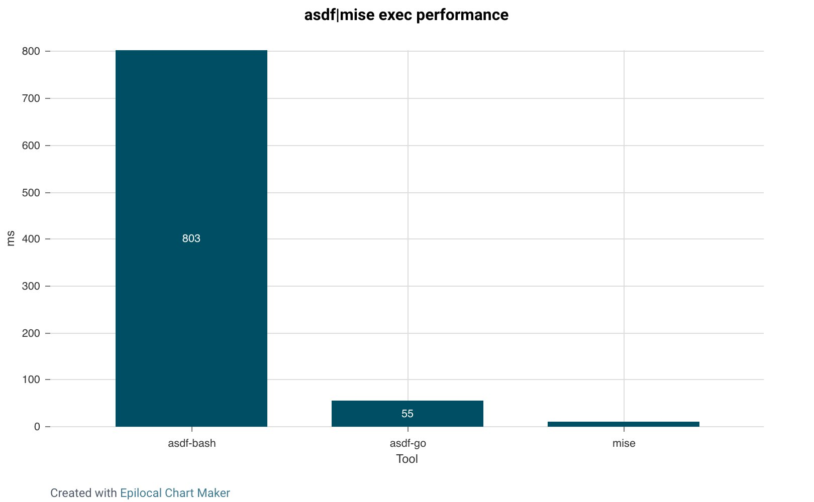

# asdf との比較 {#comparison-to-asdf}

mise は asdf の代替としてそのまま使用できます。asdf で使っていたのと同じ `.tool-versions` ファイルをサポートしており、[asdf バックエンド（原文）](https://mise.jdx.dev/dev-tools/backends/asdf.html) を通じて asdf プラグインを使用することもできます。

しかし、既存の asdf ディレクトリを再利用することはありません（そのため、再インストールするか移動する必要があります）。また、100% の互換性は設計目標ではありません。とはいえ、asdf-bash（0.15 以下）から移行する場合、mise は 100% の互換性が設計目標でないにもかかわらず、実際には [asdf-go（0.16 以上）よりも破壊的変更が少ない](https://asdf-vm.com/guide/upgrading-to-v0-16.html) です。

asdf から来たカジュアルなユーザーは、総じて mise を「より速く、使いやすい asdf」だと感じています。

:::tip
asdf には存在しない mise の主要な機能である [環境](/environments/) と [タスク](/tasks/) を、必ず確認してください。
:::

## asdf から mise への移行 {#migrate-from-asdf-to-mise}

asdf から mise へ移行する場合は、ガイダンスとして [#how-do-i-migrate-from-asdf](/faq.html#how-do-i-migrate-from-asdf) を確認してください。

## asdf の go 版 (0.16+) {#asdf-in-go-0-16}

asdf は go で書き直されました。これは執筆時点 (2025-01-01) ではまだかなり新しいため、0.16 以上の asdf バージョン（私はこれを "asdf-bash" と対比して "asdf-go" と呼んでいます）に関する情報はこのセクションにまとめ、このドキュメントの残りの部分は asdf-bash（0.15 以下）に対して書かれたものとします。

パフォーマンスの面では、mise は go 版の asdf よりも依然として速いですが、その差はかなり縮まっています。asdf-go と mise のオーバーヘッドの差は、あなたが気づかない程度に十分小さいかもしれません — 結局のところ、asdf-bash を使い続けていて、その遅さに気づいていないと主張する人はまだたくさんいます（なぜそうなのかは私に聞かないでください）。



とはいえ、asdf-go が存在する今、パフォーマンスは乗り換える十分な理由にはならないと思います。理由の1つではありますが、小さな理由です。mise のセキュリティの向上、より良い DX、そして shim に依存しないことは、いずれもパフォーマンスより重要です。

彼らが asdf を書き直す手間をかけたということは、今後も開発を続けたいという意思の表れでもあります（ちなみに、それをやっていることは素晴らしいことです）。つまり、彼らが asdf の問題点のいくつかに対処すれば、ここに書かれている内容の一部は古くなる可能性があるということです。

## サプライチェーンセキュリティ {#supply-chain-security}

asdf プラグインは安全ではありません。これについては [SECURITY.md](https://github.com/jdx/mise/blob/main/SECURITY.md) で説明していますが、簡単に言えば、asdf プラグインにはシェルコードが含まれており、それは実質的にマシン上で何でもできてしまいます。危険なコードです。さらに悪いことに、asdf プラグインがツールのベンダー（そもそもツールを使うために信頼する必要がある相手）によって書かれていることはほとんどなく、つまり使用する asdf プラグインのすべてについて、無名の開発者が暴走しないこと、そして自身がハッキングされてエクスプロイト入りの変更をプラグインに公開されないことを信頼することになります。

mise は一部のツールについて今でも asdf プラグインを使用していますが、その数を積極的に減らしており、[mise-plugins 組織](https://github.com/mise-plugins) への移行も進めています。asdf にも asdf-community という同様の仕組みがあるように見えますが、実際は違います。asdf は、プラグインを移してきた作者に対して [asdf-community](https://github.com/asdf-community) 内のそのプラグインへのコミット権限を与えており、それでは専用の組織を用意した目的が損なわれてしまうと感じています。2025年末までには、レジストリに私が所有していない asdf プラグインが残らないようにしたいと考えています。

また、ベンダーがその機能を提供している場合には、追加のセキュリティ検証手順も採用しています。例えば node のインストールにおける gpg 検証や、aqua ツールに対するネイティブな Cosign/SLSA/Minisign/GitHub attestation 検証などです。

## UX {#ux}


コマンドの一部は asdf と同じですが、変更されているものもあります。asdf で可能なことはすべて mise でも可能なはずですが、構文が少し異なる場合があります。mise はより柔軟なコマンドを備えており、例えばあいまい一致（fuzzy-matching）を使って `mise install node@20` のように書けます。一方 asdf では `asdf install node latest:20` を実行することは_できます_が、`latest:20` を `.tool-versions` ファイルやその他多くの場所で使うことはできません。`mise` ではどこでもあいまい一致を使用できます。

asdf では、プラグインがインストールされていない新しいランタイムをインストールするために、いくつかの手順が必要です。例えば:

```sh
asdf plugin add node
asdf install node latest:20
asdf local node latest:20
```

`mise` では、これをすべて1つのステップで行うことができ、プラグインのインストール、ランタイムのインストール、バージョンの設定が同時に行われます:

```sh
mise use node@20
```

既存の `.tool-versions` ファイルや `.mise.toml` がある場合、単一のコマンドですべてのプラグインとランタイムをインストールできます:

```sh
mise install
```

私は asdf が特に硬直的で学習しづらいと感じています。`asdf list all` はあるのに `asdf latest --all` という奇妙な判断もされています（なぜ一方はオプションで、もう一方は位置引数なのでしょうか）。`mise` はエイリアスを多用しているため、`mise plugin add node` なのか `mise plugin install node` なのかを覚えておく必要がありません。あなたが何を意図しているか推測できる場合は、mise がその意図どおりに応答するようにしています。

とはいえ、asdf には多くの優れた点があります。現時点で最良のマルチランタイムマネージャーであり、そのプラグインシステムには本当に感心しています。作者が下した設計上の判断のほとんどは非常に優れています。私が本当に不満に思っているのは2点だけです。shim と、それが Bash で書かれているという点です。

## パフォーマンス {#performance}

asdf は、ランタイムへの呼び出しとランタイム自体の間に shim を挟むという（私が思うに）まずい設計判断をしています。例えば、`node` を呼び出すと、asdf の shim ファイル `~/.asdf/shims/node` が呼び出され、それが `asdf exec` を呼び出し、それが正しいバージョンの node を呼び出します。

これらの shim のパフォーマンスはひどく、すべてのランタイム呼び出しに ~120ms 加算されます。`mise activate` は shim を使わず、代わりに `PATH` を更新するので、単にバイナリを呼び出すだけであればオーバーヘッドはありません。この shim こそが、私がこれを書いた主な理由です。この README の先頭にあるデモ GIF では、この理由により `node -v` を呼び出す際に実際には `mise` が使われていない点に注意してください。パフォーマンスは、mise を使わずに node を実行した場合と同一です。

asdf がこれらの問題を解決することは不可能だと思います。asdf の作者は [パフォーマンスの問題](https://stratus3d.com/blog/2022/08/11/asdf-performance/) について素晴らしい記事を書いています。asdf は bash で書かれているため、パフォーマンスを出すのが難しいのは確かですが、本当の問題は shim の設計にあると思います。完全な書き直しなしにそれを修正することは不可能だと思います。

mise もディレクトリが変わるたびに内部コマンド `mise hook-env` を呼び出しますが、Rust で書かれているためこれは非常に速く、私のマシンでは ~10ms 程度です。変更がない場合は 4ms、フルリロードの場合は 14ms です。

tl;dr: asdf はランタイムを呼び出す際に ~~120ms のオーバーヘッドを追加しますが、mise はプロンプトが読み込まれる際に ~~5ms の小さなオーバーヘッドを追加するだけです。

## Windows サポート {#windows-support}

asdf は Windows 上ではまったく動作しません。mise では、asdf 以外のバックエンドを使うツールは Windows をサポートできます。もちろん、これはツールのベンダーが Windows 用バイナリを提供する必要があることを意味しますが、それが提供されていて、バックエンドが asdf でなければ、そのツールは Windows で動作するはずです。

## セキュリティ {#security}

asdf プラグインは安全ではありません。通常、それらは元となるツールを提供するベンダーとは無関係の個人によって書かれています。可能な場合、mise は asdf プラグインを使わず、別途プラグインを必要としない aqua や github といったバックエンドを使用します。

aqua のツールには、mise に組み込まれたネイティブな Cosign/SLSA/Minisign/GitHub attestation 検証が含まれます。詳細は [SECURITY](https://github.com/jdx/mise/blob/main/SECURITY.md) を参照してください。

## コマンドの互換性 {#command-compatibility}

ほぼすべての箇所で asdf で使える構文をそのまま使用できますが、これはヘルプや CLI リファレンスには載っていないでしょう。asdf から来て、その使い方に慣れている場合は、ほとんど常に mise でも同じ構文を使用できます。例えば:

```sh
mise install node 20.0.0
mise local node 20.0.0
```

更新 (2025-01-01): asdf-go（0.16 以上）は実際には `asdf global|local` を完全に廃止し、`asdf set` に置き換えました。これは、既に `mise set` という名前のコマンドがあるためサポートできません。mise のコマンド互換性は asdf-go 0.16 以上ではおそらく良くないでしょう。

ただし、これは推奨されていません。ほとんどの場合、設定ファイルを変更してからインストールしたいはずなので、`mise use node@20` の方が1コマンド分節約できます。また、コマンド内の "@" は複数のツールを一度にインストールできるため好まれます: `mise use|install node@20 node@18`。また、どちらの構文が使われているかを確実に判定することが不可能、あるいは少なくとも非常に難しいエッジケースもあり、その場合は mise 方式をデフォルトとします。こうしたケースは多くありませんが、asdf 互換性は、体に馴染んだ操作感に頼れる asdf からの移行者に馴染みやすく感じてもらうための "ベストエフォート" として実装されています。asdf 構文がすべてで動作することを保証するのは設計目標ではありません。

## 追加のバックエンド {#extra-backends}

mise は asdf プラグイン以外のバックエンドにも対応しています。例えば、cargo や npm から直接 CLI をインストールできます:

```sh
mise use -g cargo:ripgrep@14
mise use -g npm:prettier@3
```
