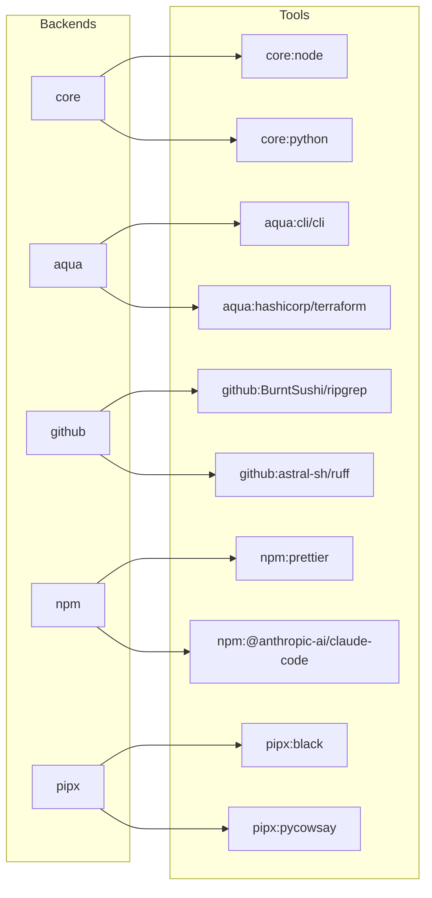

<!-- markdownlint-disable MD034 -->

# はじめに {#getting-started}

mise をわずか数分で使い始められます。

## 1. `mise` CLI のインストール {#installing-mise-cli}

mise をインストールする他の方法（`macport`, `apt`, `yum`, `nix` など）については、[mise のインストール](/installing-mise) を参照してください。

:::tabs key:installing-mise
== Linux/macOS

```shell
curl https://mise.run | sh
```

デフォルトでは mise は `~/.local/bin` にインストールされますが、他の場所にすることもできます。

インストールを確認します。

```shell
~/.local/bin/mise --version
# mise 2024.x.x
```

- `~/.local/bin` を `PATH` に含める必要はありません。mise は[有効化](#activate-mise)されると、自動的に自身のディレクトリを `PATH`
  に追加します。

== Windows
::: code-group

```shell [scoop]
scoop install mise
```

```shell [winget]
winget install jdx.mise
```

```shell [chocolatey]
choco install mise
```

== Debian/Ubuntu (apt)

```sh
sudo apt install -y extrepo
sudo extrepo enable mise
sudo apt update
sudo apt install -y mise
```

== Fedora 41+, RHEL/CentOS Stream 9+ (dnf)

```sh
sudo dnf copr enable jdxcode/mise
sudo dnf install mise
```

詳細については [copr ページ](https://copr.fedorainfracloud.org/coprs/jdxcode/mise/) を参照してください。

== Snap

```sh
sudo snap install mise --classic
```

詳細については [snapcraft.io ページ](https://snapcraft.io/mise) を参照してください。

:::

これらの場所を変更したい場合、`mise` は [`MISE_DATA_DIR`](/configuration) と [`XDG_DATA_HOME`](/configuration) を尊重します。

## 2. mise の `exec` と `run` {#mise-exec-run}

インストールが完了すれば、すぐに mise で [ツール](/dev-tools/) のインストールと実行、[タスク](/tasks/) の起動、[環境変数](/environments/) の管理ができます。

特定バージョンのツールを実行する最も手早い方法は [`mise x|exec`（原文）](https://mise.jdx.dev/cli/exec.html) です。例えば、Python 3 の REPL を起動するには:

::: tip
`mise` がまだ `PATH` 上にない場合は、代わりに `~/.local/bin/mise` を使用してください。
:::

```sh
mise exec python@3 -- python
# this will download and install Python if it is not already installed
# Python 3.15.0
# >>> ...
```

または node 26 を実行するには:

```sh
mise exec node@26 -- node -v
# v26.x.x
```

ツールを永続的にインストールするには、[`mise u|use`（原文）](https://mise.jdx.dev/cli/use.html) を使用します:

```shell
mise use --global node@26 # install node 26 and set it as the global default
mise exec -- node my-script.js
# run my-script.js with node 26...
```

[`mise r|run`（原文）](https://mise.jdx.dev/cli/run.html) を使うと、mise のコンテキスト（ツール + 環境変数）を完全に読み込んだ状態で [タスク](/tasks/) やスクリプトを実行できます。

::: tip
シェルの rc ファイルに `alias x="mise x --"` のようなシェルエイリアスを設定すると、キー入力を減らせます。
:::

## 3. `mise` を有効化する <Badge text="optional" /> {#activate-mise}

`mise exec` は単発のコマンドには最適ですが、インタラクティブシェルでは、ツールと環境変数が自動的に読み込まれるように mise を有効化しておくとよいでしょう。

アプローチは2つあります:

- [`mise activate`（原文）](https://mise.jdx.dev/cli/activate) — プロンプトが実行されるたびに `PATH` と環境を更新します。インタラクティブシェルで推奨されます。
- [shim](dev-tools/shims.md) — コマンドを横取りして正しい環境を読み込むシンボリックリンクです。CI/CD、IDE、スクリプトに適しています。[shim は `mise activate` の全機能をサポートしていない](/dev-tools/shims.html#shims-vs-path) 点に注意してください。

どちらも使わず、直接 `mise exec` や `mise run` を呼び出すこともできます。
詳細については [このガイド](dev-tools/shims.md) を参照してください。

シェルで mise を有効化する方法は次のとおりです:

:::tabs key:installing-mise

== https://mise.run

::: code-group

```sh [bash]
echo 'eval "$(~/.local/bin/mise activate bash)"' >> ~/.bashrc
```

```sh [zsh]
echo 'eval "$(~/.local/bin/mise activate zsh)"' >> ~/.zshrc
```

```sh [fish]
echo '~/.local/bin/mise activate fish | source' >> ~/.config/fish/config.fish
```

== Brew

::: code-group

```sh [bash]
echo 'eval "$(mise activate bash)"' >> ~/.bashrc
```

```sh [zsh]
echo 'eval "$(mise activate zsh)"' >> ~/.zshrc
```

```sh [fish]
# do nothing! mise is automatically activated when using brew and fish
# you can disable this behavior with `set -Ux MISE_FISH_AUTO_ACTIVATE 0`
```

== Windows

次の内容を PowerShell プロファイル（`$PROFILE`）に追加します:

```powershell
(&mise activate pwsh) | Out-String | Invoke-Expression
```

PowerShell プロファイルを開く必要がある場合:

```powershell
# create profile if it doesn't already exist
if (-not (Test-Path $profile)) { New-Item $profile -Force }
# open the profile
Invoke-Item $profile
```

- PowerShell を使用していない場合は、`<homedir>\AppData\Local\mise\shims` を `PATH` に追加してください。

== その他のパッケージマネージャー

::: code-group

```sh [bash]
echo 'eval "$(mise activate bash)"' >> ~/.bashrc
```

```sh [zsh]
echo 'eval "$(mise activate zsh)"' >> ~/.zshrc
```

```sh [fish]
echo 'mise activate fish | source' >> ~/.config/fish/config.fish
```

:::

rc ファイルを変更した後は、シェルセッションを再起動してください。すべてが正しく設定されているかを確認するには、[`mise dr|doctor`（原文）](https://mise.jdx.dev/cli/doctor.html) を実行します。

mise を有効化すると、ツールは直接 `PATH` 上で使用できるようになります:

```sh
mise use --global node@26
node -v
# v26.x.x
```

`mise use --global node@26` を実行すると、mise はグローバル設定を更新します:

```toml [~/.config/mise/config.toml]
[tools]
node = "26"
```

### シェル機能の対応状況 {#shell-feature-compatibility}

すべてのシェルが mise のすべての機能をサポートしているわけではありません:

| 機能                            | Bash | Zsh | Fish | Nushell | Elvish | Xonsh | PowerShell |
| ------------------------------- | ---- | --- | ---- | ------- | ------ | ----- | ---------- |
| `mise activate`                 | はい  | はい | はい  | はい     | はい    | はい   | はい        |
| `mise shell`                    | はい  | はい | はい  | はい     | はい    | はい   | はい        |
| シェルエイリアス（`[shell_alias]`） | はい  | はい | はい  | いいえ      | いいえ     | はい   | いいえ         |
| `chpwd` フック                    | はい  | はい | はい  | はい     | はい    | はい   | はい        |

## 4. バックエンド（npm, pipx, core, aqua, github）からツールを利用する {#tool-backends}



バックエンドとは、mise がツールを取得するパッケージエコシステムです。`mise use` を使えば、これらのどこからでもインストールできます。

npm から [claude-code](https://www.npmjs.com/package/@anthropic-ai/claude-code) をインストールします:

```sh
# one-off
mise exec npm:@anthropic-ai/claude-code -- claude --version

# or install globally
mise use --global npm:@anthropic-ai/claude-code
claude --version
```

pipx を使って PyPI から [black](https://github.com/psf/black) をインストールします:

```sh
# one-off
mise exec pipx:black -- black --version

# or install globally
mise use --global pipx:black
black --version
```

GitHub のリリースから直接 [ripgrep](https://github.com/BurntSushi/ripgrep) をインストールします:

```sh
# one-off
mise exec github:BurntSushi/ripgrep -- rg --version

# or install globally
mise use --global github:BurntSushi/ripgrep
rg --version
```

上記の `mise use` コマンドはそれぞれ設定ファイルを更新します。例えば、3つすべてをグローバルに実行した後、`~/.config/mise/config.toml` は次のようになります:

```toml [~/.config/mise/config.toml]
[tools]
"npm:@anthropic-ai/claude-code" = "latest"
"pipx:black" = "latest"
"github:BurntSushi/ripgrep" = "latest"
```

`mise use` を使う代わりに `mise.toml` を直接編集することもできます — 効果は同じです。編集後に `mise install` を実行すると、ツールがインストールされます。

他のエコシステムや詳細については [バックエンド（原文）](https://mise.jdx.dev/dev-tools/backends/) を参照してください。

## 設定ファイルの信頼 {#trust}

あなたやチームメイトがプロジェクトに `mise.toml` を追加すると、mise は env ディレクティブやフックを実行する前に、それを信頼するかどうかを確認します:

```
mise ~/my-project/mise.toml is not trusted. Trust it? [y/n]
```

これはセキュリティ対策です — 設定ファイルは `[env]` ディレクティブ、フック、タスクを通じて任意のコードを実行できます。ファイルを信頼するには、次を実行します:

```sh
mise trust
```

これはファイルごとに一度だけ行う必要があります。詳細は [`mise trust`（原文）](https://mise.jdx.dev/cli/trust) を参照してください。

信頼の確認を完全に無効化するには、ルートパスを信頼します:

```sh
mise settings trusted_config_paths=["/"]
```

または、環境変数 `MISE_TRUSTED_CONFIG_PATHS=/` を設定します。

::: tip
`mise use` は自身が作成したファイルを自動的に信頼するため、このプロンプトが表示されるのは、他の人が書いた設定を取得したときや `mise.toml` を手動で編集したときだけです。
:::

## 5. 環境変数の設定 {#environment-variables}

`mise.toml` で環境変数を定義します — mise が有効化されているとき、または `mise exec` を使用するときに常に読み込まれます:

```toml [mise.toml]
[env]
NODE_ENV = "production"
```

```sh
mise exec -- node --eval 'console.log(process.env.NODE_ENV)'

# or if mise is activated in your shell
echo "node env: $NODE_ENV"
# node env: production
```

## 6. タスクの実行 {#run-a-task}

`mise.toml` でタスクを定義し、`mise run` で実行します:

```toml [mise.toml]
[tasks]
hello = "echo hello from mise"
```

```sh
mise run hello
# hello from mise
```

:::tip
mise はタスクを実行する前に、`mise.toml` に記載されたすべてのツールを自動的にインストールします。
:::

タスクの定義と実行の詳細については [タスク](/tasks/) を参照してください。

## 7. 次のステップ {#next-steps}

mise の使い方についてさらに例を見るには [ウォークスルー](/walkthrough) を参照してください。

### 自動補完の設定 {#autocompletion}

シェルの自動補完を設定する方法については [自動補完](/installing-mise.html#autocompletion) を参照してください。

### GitHub API のレート制限 {#github-api-rate-limiting}

::: warning
mise の多くのツールは GitHub API を必要とします。認証されていないリクエストはレート制限されることが多く — 4xx エラーが表示された場合は、認証の設定方法について [GitHub トークン（原文）](https://mise.jdx.dev/dev-tools/github-tokens.html) を参照してください。
:::
