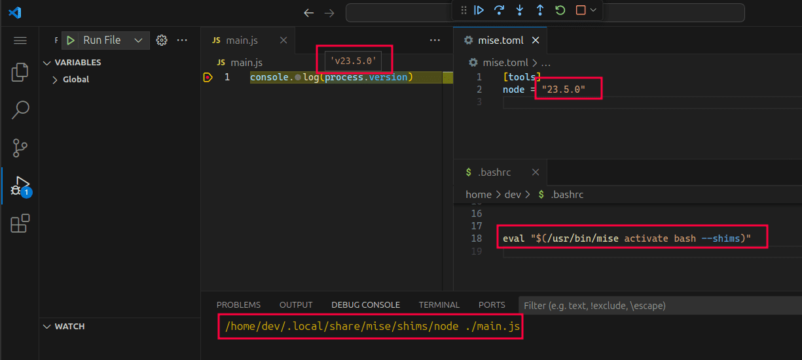
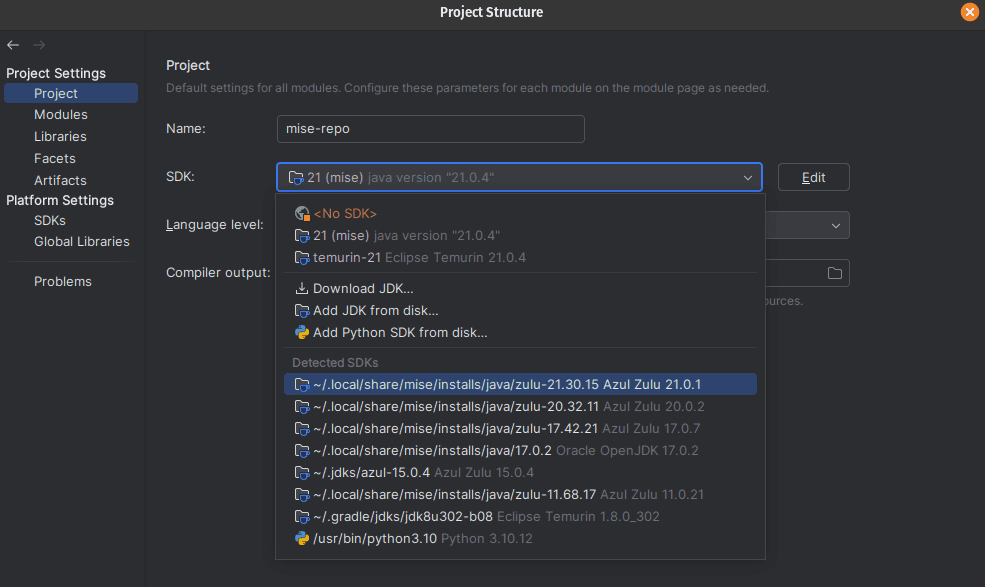

# エディターと IDE {#editors-and-ides}

エディターの統合ターミナル、言語サーバー、デバッガー、拡張機能は、それぞれ異なる環境で動作することがあります。ツールや変数を必要としているのがどのプロセスかを確認し、次の中から連携方法を選んでください。

| 必要なもの | 連携方法 | 期待される動作 |
| --- | --- | --- |
| 固定の実行ファイルまたは SDK ディレクトリ | `mise which node` または `mise where java` | インストール済みのパスを選択します。バージョンを変更した後は IDE の設定を更新してください。 |
| 現在のプロジェクトに追従するツール | [shim](/dev-tools/shims.html) | shim の実行時にツールを解決し、mise の環境変数を読み込みます。プロセスはプロジェクトのディレクトリで実行する必要があります。 |
| プロジェクトの環境で実行するコマンド | `mise exec -- command` | そのコマンドとその子プロセスに対してツールと変数を読み込みます。 |
| 設定の変更に追従するエディターの機能 | [エディタープラグイン](#ide-plugins) | 対応状況はエディター、拡張機能、言語によって異なります。 |

まずプロジェクトで `mise install` を実行してください。SDK のパスを選択するだけでは `[env]` は読み込まれません。また、shim はすでに起動しているエディターの環境を変更しません。そのため、引き継がれる環境や固定の SDK パスを変更した後は、影響を受ける言語サーバーまたはエディターを再起動してください。

## グローバルバージョンへの固定パス {#global-version-link}

IDE の Maven や JDK のホームのように、インストールディレクトリを受け取る設定項目には、バージョンを変更しても変わらないパスが必要です。各ツールのインストールディレクトリには、グローバル設定とシステム設定が選択しているバージョンを指す `global` リンクがあります。

```sh
~/.local/share/mise/installs/maven/global -> ./3.9.16
```

mise は、`mise use -g` や `mise install` の後など、他のランタイムのシンボリックリンク（`latest`、`3`）を作り直すたびにこのリンクを更新します。プロジェクトの設定や `MISE_*_VERSION` 変数はこのリンクを変更しません。また、どのグローバル設定でも選択されていないツールにはリンクがありません。`global` という名前の実体のディレクトリがある場合、mise はそれに手を触れません。

## GUI エディター向けに shim を PATH に追加する {#adding-shims-to-path-default-shell}

VS Code や JetBrains IDE など、デスクトップから起動したエディターは、ログインシェルの環境を読み込みます。mise の [shim](/dev-tools/shims.html) をそのシェルのログインプロファイルに追加すると、プロンプトフックなしでこれらのエディターが mise のツールを見つけられるようになります。ログインシェルは次のようにして確認できます。

::: code-group

```sh [macOS]
dscl . -read /Users/$USER UserShell
```

```sh [Linux]
getent passwd $USER | cut -d: -f7
```

:::

次に、[shim を PATH に追加する](/dev-tools/shims.html#how-to-add-mise-shims-to-path)に示す方法で、そのシェルのログインプロファイルに `mise activate --shims` を追加します。Bash がどのファイルを読み込むかもそこで説明しています。プロファイルの実行時に `mise` が `PATH` 上にない場合は、絶対パスを使ってください。例: `eval "$($HOME/.local/bin/mise activate zsh --shims)"`。

プロファイルを編集した後はエディターを再起動してください。デスクトップ環境によってはログイン時にしかログインプロファイルを読み込まないため、ログアウトして再度ログインする必要がある場合があります。エディターがシェルのプロファイルをまったく読み込まない場合は、エディターの環境に関する設定を確認してください。VS Code の[環境の解決](https://code.visualstudio.com/docs/terminal/advanced#_environment-inheritance)と、その[タスク用ターミナルプロファイル](#vscode-automation-profile-for-macos)は別々の仕組みです。

VS Code と IntelliJ が、mise が shim 経由で提供する `node` を使用している例です。

::: tabs
== VS Code



== IntelliJ

:::

shim が `[env]` の変数を設定するのは、shim が起動したツールのプロセスに対してだけです。エディター自体や、環境を直接読み取る機能からはそれらの変数は見えません。そうした用途には[エディタープラグイン](#ide-plugins)を使ってください。

## エディタープラグイン {#ide-plugins}

mise と連携するコミュニティのプラグインです。

| エディター | プラグイン | 機能 |
| --- | --- | --- |
| VS Code | [mise-vscode](https://marketplace.visualstudio.com/items?itemName=hverlin.mise-vscode) | ツールとタスクの管理、プロジェクトの環境の読み込み、設定の編集の補助を行い、言語拡張機能が mise のツールを使うように設定することもできます。 |
| JetBrains IDE | [intellij-mise](https://github.com/134130/intellij-mise) | mise から IDE の SDK を設定し、mise のタスクを実行し、実行構成で環境変数を読み込みます。 |
| Neovim | [miser.nvim](https://github.com/carldaws/miser.nvim) | `mise.toml` 内のツールに対応する言語サーバーとフォーマッターを起動し、Neovim から mise のタスクを実行します。 |
| Emacs | [mise.el](https://github.com/eki3z/mise.el) | バッファごとに mise の環境を読み込みます。 |

## VS Code {#vscode}

[mise-vscode 拡張機能](https://hverlin.github.io/mise-vscode/)は、[対応している言語拡張機能](https://hverlin.github.io/mise-vscode/reference/supported-extensions/)が mise のツールを使うように設定できます。この機能はデフォルトでは無効です。有効にするには [`mise.configureExtensionsAutomatically`](https://hverlin.github.io/mise-vscode/reference/settings/#miseconfigureextensionsautomatically) を有効にしてください。環境とタスクに関する設定項目については、拡張機能のドキュメントを参照してください。

mise は拡張機能を実行するマシンにインストールしてください。ローカルにインストールした mise は、SSH ホスト、WSL ディストリビューション、[dev container](#dev-containers) の中にはツールを提供しません。

### タスクとデバッグ用のターミナル {#vscode-automation-profile-for-macos}

VS Code はタスクとデバッグセッションをオートメーション用ターミナルで実行します。このターミナルが、プロファイルを（つまり shim も）読み込むログインシェルを起動するようにするには、`settings.json` に[オートメーションプロファイル](https://code.visualstudio.com/docs/terminal/profiles#_configuring-the-taskdebug-profile)を追加します。

::: code-group

```json [macOS]
{
  "terminal.integrated.automationProfile.osx": {
    "path": "/bin/zsh",
    "args": ["--login"]
  }
}
```

```json [Linux]
{
  "terminal.integrated.automationProfile.linux": {
    "path": "/bin/bash",
    "args": ["--login"]
  }
}
```

:::

オートメーションプロファイルは、拡張機能ホストやすべての言語サーバーを設定するものではありません。shim はログインプロファイルに残しておいてください。`--interactive` を追加すると、インタラクティブシェル用の起動ファイルも読み込まれますが、そこにはビルドに不要なプロンプトのカスタマイズなども含まれます。

### launch.json で mise exec を使ってデバッグする {#use-mise-exec-in-launch-configuration}

プロジェクトのツールで Node.js をデバッグするには、`launch.json` でランタイムを [`mise exec`（原文）](https://mise.jdx.dev/cli/exec.html) 経由で実行します。`cwd` には `mise.toml` があるディレクトリを指定してください。エディターが `mise` を見つけられない場合は、`runtimeExecutable` に絶対パスを指定します。次の例は macOS と Linux 向けです。

```json
{
  "version": "0.2.0",
  "configurations": [
    {
      "type": "node",
      "request": "launch",
      "name": "Launch Program",
      "program": "${file}",
      "cwd": "${workspaceFolder}",
      "runtimeExecutable": "mise",
      "runtimeArgs": ["exec", "--", "node"]
    }
  ]
}
```

## JetBrains IDE {#jetbrains-editors-intellij-rustrover-pycharm-webstorm-rubymine-goland-etc}

この節の内容は、IntelliJ IDEA、PyCharm、WebStorm、GoLand、RubyMine、RustRover などの JetBrains IDE に当てはまります。[intellij-mise プラグイン](https://github.com/134130/intellij-mise)は、mise から SDK を自動的に設定します。

### SDK を直接選択する {#direct-sdk-selection}

IntelliJ IDEA の Java SDK の選択画面は、mise がインストールした JDK を検出します。



### asdf レイアウトを使った SDK 選択 {#sdk-selection-using-asdf-layout}

一部の言語プラグインは、mise がインストールした SDK は見つけられなくても、asdf の SDK は見つけられます。直接選択できる場合はそちらを優先してください。プラグインが asdf のディレクトリを必要とし、`~/.asdf` が存在しない場合は、シンボリックリンクで mise のレイアウトを公開できます。既存の asdf のインストールを置き換えないでください。また、mise が管理しているインストールを asdf で変更しないでください。

```sh
ln -s ~/.local/share/mise ~/.asdf
```

すると、SDK が Project Settings に表示されます。


Node.js やその他いくつかの言語では、この設定は「Languages & Frameworks」の下にあります。


## Neovim {#neovim}

以下の Vim、Neovim、Emacs のスニペットはデフォルトのデータディレクトリを使っています。`MISE_DATA_DIR` を設定している場合は、代わりに `$MISE_DATA_DIR/shims` を使ってください。

```lua
-- Prepend mise shims to PATH
vim.env.PATH = vim.env.HOME .. "/.local/share/mise/shims:" .. vim.env.PATH
```

Treesitter と言語サーバーのセットアップについては、[Neovim クックブック（原文）](https://mise.jdx.dev/mise-cookbook/neovim.html)を参照するか、[miser.nvim](https://github.com/carldaws/miser.nvim) を使ってください。

## Vim {#vim}

```vim
" Prepend mise shims to PATH
let $PATH = $HOME . '/.local/share/mise/shims:' . $PATH
```

## Emacs {#emacs}

shim を使う場合:

```lisp
(let ((mise-shims (expand-file-name "~/.local/share/mise/shims")))
  (setenv "PATH" (concat mise-shims (char-to-string path-separator) (getenv "PATH")))
  (add-to-list 'exec-path mise-shims))
```

代わりにバッファごとに mise の環境を読み込むには、[mise.el](https://github.com/eki3z/mise.el) をその README に従ってインストールし、有効にします。

```lisp
(require 'mise)
(add-hook 'after-init-hook #'global-mise-mode)
```

## Xcode {#xcode}

Xcode のビルドフェーズは、インタラクティブシェルの起動ファイルを実行しません。mise の絶対パスを使い、プロジェクトのディレクトリを明示的に指定してください。SwiftLint を宣言しているプロジェクトの場合:

```sh
"$HOME/.local/bin/mise" --cd "$SRCROOT" exec -- swiftlint lint
```

ビルドの前にプロジェクトのツールをインストールしておいてください。パッケージマネージャーで mise をインストールした場合は、mise のパスを調整してください。

User Script Sandboxing が有効な場合は、ビルドフェーズでスクリプトの入力と出力を宣言してください。`$(SRCROOT)/mise.toml` は入力の 1 つですが、mise やツールは他の設定ファイル、インストール済みの実行ファイル、データディレクトリも読み込む場合があるため、`mise.toml` だけを許可してもすべてのツールで十分とは限りません。不足しているものは、ビルドログに出るサンドボックスの拒否を見て特定してください。Xcode Cloud については[継続的インテグレーション](/continuous-integration.html#xcode-cloud)を参照してください。

## Dev container {#dev-containers}

[`mise generate devcontainer`（原文）](https://mise.jdx.dev/cli/generate/devcontainer.html) は、mise の dev container feature と mise-vscode 拡張機能を追加する、出発点となる `.devcontainer/devcontainer.json` を作成します。

```sh
mise generate devcontainer --write
```

このファイルは `postCreateCommand` を `mise install` に設定するため、新しいコンテナではプロジェクトのツールがインストールされます。`--mount-mise-data` を指定すると mise のデータディレクトリ用の名前付きボリュームが追加され、コンテナを再ビルドしてもインストール済みのツールが残ります。ビルドする前にイメージとマウントを確認してください。ホームディレクトリがホストからマウントされるイメージにツールを事前インストールする方法については、[Docker（原文）](https://mise.jdx.dev/mise-cookbook/docker.html#devcontainers-with-home-directory-mounts)を参照してください。

## Windows {#windows}

[Windows のシェル（原文）](https://mise.jdx.dev/shell-setup.html#windows)に示す方法で `%LOCALAPPDATA%\mise\shims` をユーザーの `Path` に追加し、エディターが mise のツールを見つけられるようにしてから、エディターを再起動してください。拡張機能が `spawn EINVAL` を報告する場合は、[トラブルシューティング](/troubleshooting.html#vscode-for-windows-extension-with-error-spawn-einval)を参照してください。

## AI コーディングアシスタント {#ai-coding-assistants}

ターミナルでコマンドを実行するアシスタントは、他のプロセスと同じ方法、つまり有効化、shim、`mise exec` のいずれかで mise のツールを利用します。アシスタントにプロジェクトのツール、タスク、環境を読み取らせ、タスクを実行させるには、[mise MCP サーバー（原文）](https://mise.jdx.dev/mcp.html)に接続してください。packslip 経由でインストールしたツールはエージェントスキルを提供することもあります。[man ページ、自動補完、スキル（原文）](https://mise.jdx.dev/dev-tools/packslip-resources.html)を参照してください。

## エディターとの不一致を診断する {#diagnose-an-editor-mismatch}

プロジェクトのディレクトリで、選択されている実行ファイルとエディターが使っているものを比較します。

```sh
mise which node
mise exec -- node --version
```

言語サーバーやデバッガーのログで、その実行ファイルのパスと作業ディレクトリを確認してください。これらのコマンドが動作するのにエディターが別のバージョンを選択している場合は、そのプロセスの SDK 設定、`PATH`、または作業ディレクトリを修正してください。統合ターミナルが正しく動作していても、言語拡張機能が同じ環境を使っているとは限りません。
